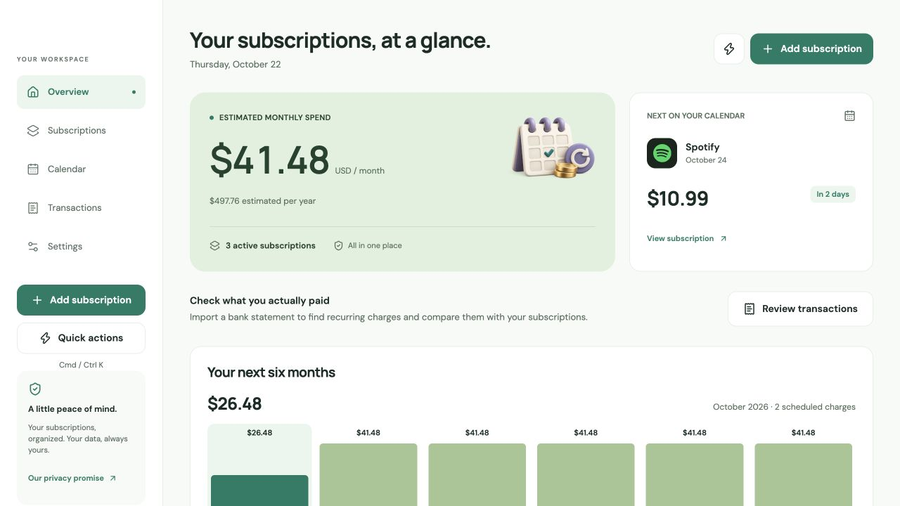
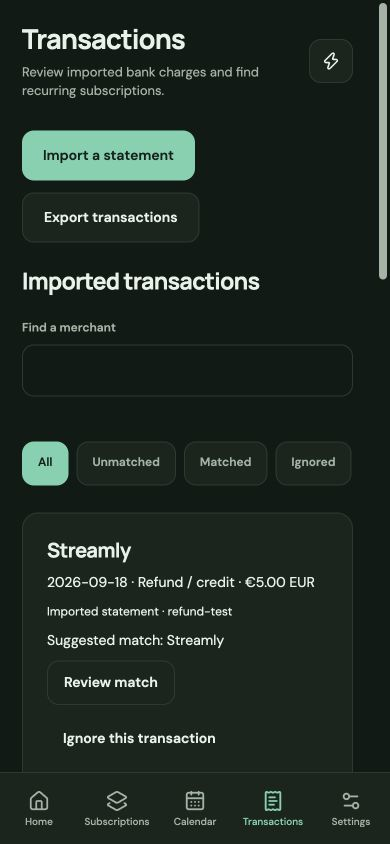

<p align="center">
  <a href="https://subloom.baltii.tn">
    
  </a>
</p>

<p align="center">
  <strong>A calmer place for your subscriptions.</strong><br>
  See what renews, understand what it costs, and keep what matters.
</p>

<p align="center">
  <a href="https://github.com/Baltii/Subloom/releases"></a>
  <a href="https://github.com/Baltii/Subloom/actions/workflows/release.yml"></a>
  <a href="package.json"></a>
  <a href="package.json"></a>
  <a href="tsconfig.json"></a>
</p>

<p align="center">
  <strong><a href="https://subloom.baltii.tn">Open the app ↗</a></strong>
  &nbsp;·&nbsp; <a href="https://subloom-landing.baltii.tn">Visit the website</a>
  &nbsp;·&nbsp; <a href="https://github.com/Baltii/Subloom/releases">Releases</a>
  &nbsp;·&nbsp; <a href="https://github.com/Baltii/Subloom/issues">Share feedback</a>
</p>

<p align="center">
  <a href="#why-subloom">Why Subloom</a> ·
  <a href="#features">Features</a> ·
  <a href="#a-look-inside">A look inside</a> ·
  <a href="#run-it-locally">Run locally</a> ·
  <a href="#documentation">Documentation</a>
</p>

---

## Why Subloom

A streaming service you stopped watching. A trial you meant to cancel. A small monthly charge that quietly became a yearly expense.

Subloom brings your recurring commitments into one clear view. Track services, see the next renewal, and understand the monthly and yearly cost before deciding what deserves a place in your budget. It helps you spot the subscriptions you may have forgotten, without promising a fixed amount of savings.

Start with a personal space saved on your device. Connect an account when you want to sync across devices. **Guest tracking needs no bank connection or account.**

## Features

| A little more clarity             | What you can do                                                                                                                                                                                  |
| --------------------------------- | ------------------------------------------------------------------------------------------------------------------------------------------------------------------------------------------------ |
| **Your subscriptions, together**  | Add catalog services or custom subscriptions, with service-name suggestions, categories, notes, prices, trials, and status controls.                                                             |
| **Renewals you can see coming**   | Browse a renewal calendar, upcoming charges, and a six-month forecast. Keep month-end dates, leap years, and your timezone in view.                                                              |
| **A clearer picture of spending** | Compare monthly and yearly estimates, explore category breakdowns, set category budgets, and review recorded price changes. Original currencies stay separate.                                   |
| **Find the recurring charges**    | Import a bank-exported statement CSV, review and categorize transactions, and confirm recurring-charge suggestions before creating subscriptions.                                                |
| **Less retyping**                 | Paste receipt text, review the detected details, and confirm what gets saved. Screenshot OCR is available when its optional backend is configured.                                               |
| **Your data, your choice**        | Track offline, optionally sync through an account, import/export subscription CSVs with Pro, and export renewal dates to your calendar. Guest backups and account export/deletion controls are available. |
| **A calmer everyday interface**   | Light, dark, and system appearance; eight accent themes; responsive layouts; accessible controls; and motion that respects reduced-motion preferences.                                           |

Subloom tracks and helps you review subscriptions. Managing or canceling a service still happens with its provider; recording a cancellation in Subloom does not cancel merchant billing.

## A look inside

<p align="center">
  
</p>

<p align="center">
  <strong>Review transactions on a smaller screen</strong><br><br>
  
</p>

<sub>Real web interface, captured with illustrative records. Names and prices are examples, not current provider offers. Compact screenshots show the responsive web layout, not a native-device certification.</sub>

## Try Subloom

| Platform    | Where to start                                                                                                                                                                                                                                                       |
| ----------- | -------------------------------------------------------------------------------------------------------------------------------------------------------------------------------------------------------------------------------------------------------------------- |
| **Web app** | [Open Subloom](https://subloom.baltii.tn) — start a local workspace or sign in.                                                                                                                                                                                      |
| **Website** | [Explore the landing page](https://subloom-landing.baltii.tn).                                                                                                                                                                                                      |
| **Android** | Download a test APK from [GitHub Releases](https://github.com/Baltii/Subloom/releases), or the `android-apk` artifact in successful [Android workflow runs](https://github.com/Baltii/Subloom/actions/workflows/android-apk.yml).                                    |
| **Windows** | Download the x64 `.exe` installer from [GitHub Releases](https://github.com/Baltii/Subloom/releases), or the `windows-x64` artifact in successful [Windows workflow runs](https://github.com/Baltii/Subloom/actions/workflows/windows-exe.yml).                      |
| **macOS**   | Download an Apple silicon or Intel app ZIP from [GitHub Releases](https://github.com/Baltii/Subloom/releases), or the `macos-arm64` / `macos-x64` artifacts in successful [CI runs](https://github.com/Baltii/Subloom/actions/workflows/ci.yml). Requires macOS 14+. |
| **iOS**     | Build an Expo development client locally or through EAS.                                                                                                                                                                                                             |

New stable releases attach Android, Windows, and Mac test builds after their build jobs finish. Older releases may have fewer assets. Windows installers are unsigned; Mac apps are ad-hoc signed without Apple notarization.

Android CI APKs use a test signing key and cannot update an EAS/store-signed installation. Use a spare device, or export guest data before replacing an existing install.

<details>
<summary><strong>Reminder and integration availability</strong></summary>

- **macOS:** local renewal reminders are implemented; enable them in Settings and grant the macOS notification permission.
- **Android:** FCM credentials and build configuration are set up. Physical-device notification delivery still needs verification.
- **iOS:** APNs setup and device-delivery verification remain pending.
- **Email reminders and OCR:** require their provider configuration and live delivery checks. General-recipient email also needs a verified sender domain. Mailbox discovery is disabled and marked as an upcoming Pro feature; receipt forwarding has been retired.
- **Bank statements:** imported from files you review. Direct bank connections and automatic merchant cancellation are not enabled.

Configure optional providers separately before relying on their integrations.

</details>

## Run it locally

Use **Node.js 24** from [`.nvmrc`](.nvmrc) and npm.

```sh
git clone --branch release-candidate https://github.com/Baltii/Subloom.git
cd Subloom
npm ci
npm run dev
```

Open **[localhost:8081](http://localhost:8081)**, complete the welcome tour, and choose **Use on this device** to start an empty local workspace. Guest tracking and pasted-text receipt review need no provider credentials. Subscription CSV imports and exports require Pro.

For account sync, add the public app configuration to `.env.local` using [`.env.example`](.env.example) as a reference. Server secrets belong in backend settings, never in `EXPO_PUBLIC_*` variables or committed files.

<details>
<summary><strong>Native builds and checks</strong></summary>

The marketing website now lives in [Baltii/Subloom-Landing](https://github.com/Baltii/Subloom-Landing), with its own Next.js build, CI and Vercel deployment.

**Native development** — use an Expo development build, rather than Expo Go:

```sh
npm run android
# On macOS with Xcode installed:
npm run ios
```

Android needs its SDK/JDK tooling; iOS needs Xcode. Android Firebase builds also require the ignored local `google-services.json` or a `GOOGLE_SERVICES_JSON` file path. Cloud builds use EAS profiles.

**Verification**

```sh
npm run check             # TypeScript, lint, application and database tests
npm run check:backend     # Deno checks for Edge Functions
npm run test:backend      # Backend tests
npm run export:web       # Production web bundle
```

For desktop builds, follow the [Windows guide](windows/README.md), or run `npm run build:macos` on macOS with Xcode installed.

CI verifies native JavaScript exports, canonical brand assets, Mac builds, the Windows installer and app launch, and Android APK builds for trusted branches. Live provider/device checks are separate from these automated checks.

</details>

## Under the hood

| Layer                 | Built with                                                                                                |
| --------------------- | --------------------------------------------------------------------------------------------------------- |
| App                   | Expo 57, React Native 0.86, React 19, Expo Router                                                         |
| Desktop shells        | Electron on Windows; Swift/WebKit on macOS                                                                |
| Language and forms    | TypeScript, React Hook Form, Zod                                                                          |
| State and interaction | Zustand, TanStack Query, Reanimated, Gesture Handler                                                      |
| Local storage         | SQLite on mobile, localStorage on web and in the persistent Windows profile, native snapshot files on Mac |
| Backend               | Supabase Auth, Postgres with owner-isolating RLS, Realtime, and Edge Functions                            |
| Delivery              | GitHub Actions, Release Please, Vercel, and Expo/EAS                                                      |

## Repository contents

This app repository includes product source, build configuration, public assets, and third-party licenses. Internal feature records, agent skills, artwork prompts, and the full brand workspace are kept locally and excluded from version control. Required logo components, icons, fonts, and optimized illustrations remain included.

The [separate website repository](https://github.com/Baltii/Subloom-Landing) contains the landing and download pages.

Run `npm run check:repository` to reject accidentally tracked private or generated files. Run `node scripts/build-brand.mjs --check` to verify the committed brand assets; regenerating them requires the private canonical brand workspace.

## Contributing

Use `release-candidate` as the base for new work. Name working branches `feat/`, `fix/`, `refactor/`, `chore/`, `hotfix/`, or `doc/` followed by a short kebab-case description. Use Conventional Commits such as `feat(subscriptions): add service suggestions` and `docs: improve the setup guide`; hotfix commits use `fix`.

For a feature stack, target `release-candidate` with the first PR and target each predecessor with the next PR. State the merge order in every PR. Keep changes focused, preserve original-currency/date-only semantics and guest/account separation, and record the checks you actually ran. Found a bug or have an idea? [Open an issue](https://github.com/Baltii/Subloom/issues/new).

---

<p align="center">
  Built with care by <a href="https://github.com/Baltii">@Baltii</a>.<br>
  <sub>A little clarity for your recurring world.</sub>
</p>
