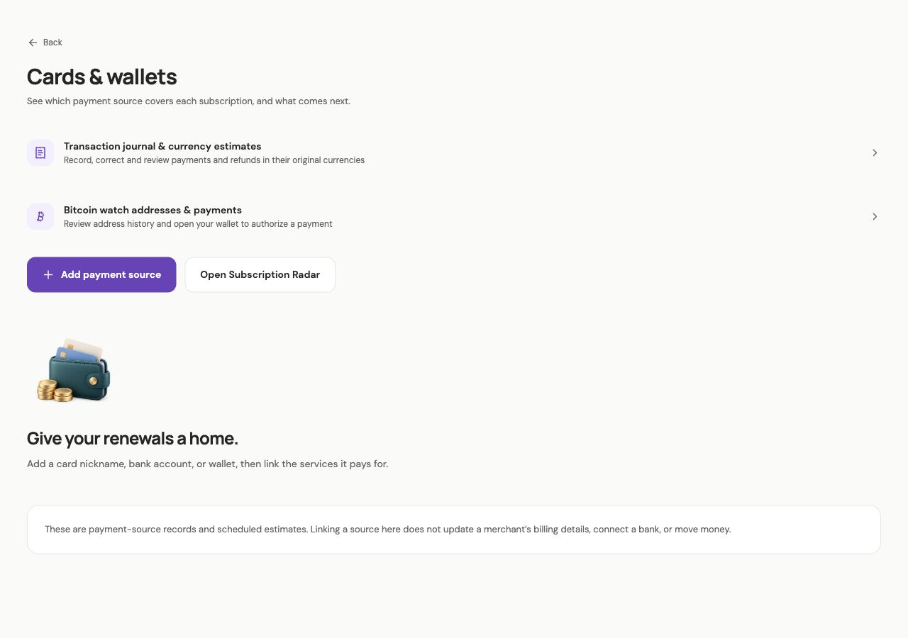
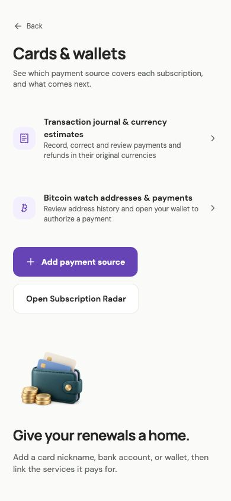

# Combined app readiness — 2026-10-17

## Current disposition

`codex/app-readiness` integrates both existing feature stacks from `release-candidate`: payment sources, statement Radar, Cancellation Watch, renewal rules, virtual plans, Reserve, Value Coach, family settlements and accent themes, plus the finance journal, dated currency estimates, Bitcoin observations/payment requests and renewal preferences.

The integrated local app is built and testable. **The hosted integration is awaiting explicit deployment approval; this is not yet a credentials-only or production-ready handoff.** Automatic approval review rejected applying migrations/deploying functions because the user had not explicitly authorized that destination and persistent deployment scope. No hosted schema, function, cron, Auth setting or secret was changed during this readiness task. No provider message or payment was sent.

Merge order: this integration PR targets `release-candidate`. It already includes the existing control-center/theme and finance feature commits. Use this integration as the combined release path; the separate feature PRs remain unchanged and need not be applied again for the same release. No PR was merged or closed.

## Completed gaps

- Payment hub links directly to the manual journal, currency estimates and Bitcoin tools. All existing settings and quick actions remain available.
- Manual transactions can be edited and deliberately deleted. Corrections preserve identity/creation time, original currency, archived card links and references to removed subscriptions. Pending/failed records stay outside spending totals. Invalid saves keep input; leaving a draft requires save/discard.
- Mac feature settings, journal data and observed histories use atomic owner-private files, migrating existing WebKit copies without deleting the source. Reset/export cover both feature stacks. Public reference rates use a separate cache. Storage failures remain visible.
- Mac social/SSO and mailbox consent use `ASWebAuthenticationSession`, returning the exact custom-scheme callback to the app that holds its PKCE verifier. Mobile/browser flows retain their own transport. Google/Apple/SSO live callbacks still require provider testing; compilation and mocked contracts do not prove those flows.
- Mac Bitcoin requests can open an installed wallet and report when none can open. The wallet still authorizes the payment; no signing/broadcast or transaction-success claim is made.
- Watched addresses and renewal preferences can be removed. The new cleanup migration removes observations for removed watches, rejects late explorer writes, and prunes intentions after subscription deletion while advancing the journal version. Other owners' data is preserved.
- Account export uses the captured owner's session and refuses delivery after a workspace switch. Feature saves also stop stale navigation/notifications after an identity change.
- Feature setup now includes every new migration. The hosted smoke script includes finance corrections, Bitcoin ownership, family ledger records, full exports and cleanup assertions. These expanded hosted checks are **prepared but not run**, pending deployment approval.

## Verification

- App checks passed: TypeScript, ESLint and **291 application/Postgres tests across 49 files**.
- Backend type checks and **24 backend tests passed**.
- Web, iOS and Android JavaScript exports passed. These are bundle checks, not physical-device tests.
- Updated ad-hoc signed Mac app compiled and passed signature verification: `build/Subloom-update.app`.
- **34 native Swift checks passed**, covering persistence, owner isolation, unsafe paths, callback validation and bridge origins.
- Browser: 1280×900 and 390×844 light layouts; TND 12.345 saved, corrected to 9.876 with one history row, and retained after reload. Invalid amounts keep the draft and display recovery. Unsaved changes show discard/keep-editing; deletion explains its scope and can be canceled. No actual wallet authorization or provider consent was performed.
- Mechanical UI detector returned no findings. Existing theme contrast/reduced-motion logic remains covered by the app suite; runtime dark/reduced-motion emulation was not performed in this pass.
- Built-bundle scan found no loaded server-secret values. This is a targeted scan of known local secret values, not a general secret certification.
- Hosted **read-only** inspection confirmed the older 11 migrations, 12 deployed functions and three existing delivery/scheduling/retention jobs. Google Auth is enabled, Apple is disabled. Existing hosted security advisors returned no errors, 13 warnings and five informational findings. These apply to the existing hosted schema, not the pending integration.





Local browser evidence: `build/readiness-evidence/hub-desktop.jpg`, `hub-mobile.jpg`, `finance-desktop.jpg` and `finance-mobile.jpg`. These contain synthetic QA data.

## Deployment awaiting approval

Target is the existing test project `fdjsmpmgrwzmqovzundx`. The reviewed dry run adds **12 migrations**: eight payment/control-center prerequisites, finance journal, exchange rates, crypto history, and `20261017095506_financial_record_cleanup.sql`. It neither seeds records nor repairs migration history.

After explicit approval, use:

```sh
npm run deploy:supabase -- --plan
npm run deploy:supabase
npm run test:live
```

Deployment updates the 14 local Edge Functions without pruning unrelated functions. Then install `supabase/ops/install-finance-cron.sql` and populate the initial reference rates using the existing cron secret without exposing it. This adds the single daily exchange-rate job at 17:30 UTC; existing reminders/retention jobs remain in place. Vault already contains the expected project URL and cron-secret names. Recheck security advisors, migration history, function versions, the expanded hosted smoke results and rate coverage before marking the account features ready.

The smoke workflow creates uniquely tagged, email-suppressed QA accounts and removes only those accounts. It does not connect personal mailboxes, send provider notifications or move money.

## Credentials and configuration still required

Never paste private credentials into source code, chat, `EXPO_PUBLIC_*`, screenshots or a PR. Use the provider dashboards, EAS credential storage and Supabase server secrets. `.env.example` lists names only.

| Integration | Current evidence / next requirement |
| --- | --- |
| Supabase | Public app configuration exists. Existing server access is available. Combined schema/functions need deployment approval, not a new account or key. |
| Google login | Enabled in current hosted Auth settings. Live consent, browser/Mac/device return and logout/isolation still need testing. Do not assume its credentials are missing merely because older notes say disabled. |
| Apple login | Disabled. Configure Services ID, Team ID, Key ID and OAuth secret derived from the `.p8` key in Supabase Auth. Register the provider callback and maintain secret renewal. |
| Gmail discovery | No `GMAIL_CLIENT_ID` or `GMAIL_CLIENT_SECRET` is configured. Needs Gmail API, read-only/offline OAuth consent and authorized test users. |
| Outlook discovery | No `OUTLOOK_CLIENT_ID` or `OUTLOOK_CLIENT_SECRET` is configured. Needs Entra delegated `Mail.Read` and `offline_access` consent. |
| Mailbox encryption | `MAILBOX_ENCRYPTION_KEY` and `MAILBOX_APP_URL` already exist. Preserve the encryption key. Both providers return to `https://fdjsmpmgrwzmqovzundx.supabase.co/functions/v1/mailbox-callback`; the app then receives its web/native return. |
| Screenshot OCR | No `GOOGLE_VISION_API_KEY` is configured. Supply a server-only key restricted to Cloud Vision and test explicit-consent OCR. Pasted receipt text works without it. |
| Email forwarding/delivery | Resend key, sender and digest-signing secret exist. `INBOUND_DOMAIN`, `RESEND_WEBHOOK_SECRET` and `RESEND_DELIVERY_WEBHOOK_SECRET` are absent. Configure verified sending/receiving domains and signed inbound/status webhooks. Temporary sender limitations still require checking before general delivery. |
| Mobile push | EAS project configuration exists; the prior setup records missing APNs/FCM credentials. Their current hosted credential-store status was not reverified. No local `google-services.json` exists. Configure APNs/FCM as needed, rebuild and test on physical devices. |
| Team SAML | Organization domain, eligible Supabase SAML setup and IdP metadata/test users are required. Live SAML configuration was not reverified in this pass. No plan upgrade is authorized. |
| Exchange rates / Bitcoin watch | No API keys are required for the implemented Frankfurter/public-explorer adapters. Account use requires deployment. A self-hosted HTTPS explorer is optional. An installed Bitcoin wallet is required to authorize payment requests. |

Provider callbacks for Google/Apple: `https://fdjsmpmgrwzmqovzundx.supabase.co/auth/v1/callback`. App return allowlist: `subloom://auth-callback` and the exact browser `/auth-callback` URL. Production HTTPS hosting and exact production redirect/mailbox URLs remain operator configuration; no production hosting configuration or store release was changed. The repository’s existing Vercel integration generated a preview after the review PR was opened; that does not deploy the pending Supabase changes.

## Release limits

The dependency audit reports **18 high-severity findings**, inherited through Expo/React Native tooling. The underlying packages are [braces](https://github.com/advisories/GHSA-vfj7-8cjw-p6xm) and [node-forge](https://github.com/advisories/GHSA-86w9-cpqp-85rv). Registry checks returned 3.0.3 and 1.4.0 as latest, both within the advisory ranges. The suggested automated fix would downgrade Expo incompatibly. No forced downgrade or arbitrary vendored security patch was applied. Reassess upstream fixes before store publication; inspect `build/app-readiness-audit.json` for the actual audit.

Hosted advisor warnings concern 12 existing intentionally guarded authenticated definer RPCs and disabled leaked-password protection. The service-only tables' lack of client policies intentionally denies client access. Keep these recorded limits visible; the existing-schema advisor response does not certify the new migration. See [RPC advisor guidance](https://supabase.com/docs/guides/database/database-linter?lint=0029_authenticated_security_definer_function_executable) and [password protection](https://supabase.com/docs/guides/auth/password-security#password-strength-and-leaked-password-protection).

Bank connections, card issuing/enforcement, automatic merchant cancellation, funds held in Reserve and real family money transfers are outside the implemented product scope. Supplying credentials alone does not turn those planning tools into banking services. Statement imports, manual transactions and renewal projections retain separate records and are not added together as verified spending.

The design-context tool also reported legacy PRODUCT metadata and an unrecognized cross-platform value. App code/platform behavior was preserved. An optional Impeccable `init` can refresh that metadata; it is not a release prerequisite.
