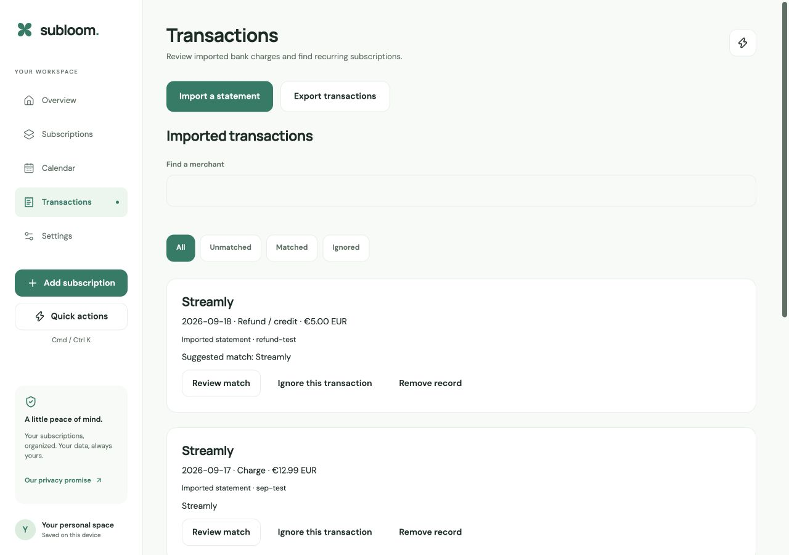

# Focused subscription tracker — 2026-10-17

Subloom now centers on tracking subscriptions, upcoming renewals and reviewed imported charges. A saved card nickname never authenticated a bank or verified a card. That setup has been removed rather than presenting it as a working financial connection.

## Scope

The five main sections are Overview, Subscriptions, Calendar, Transactions and Settings. Receipt review, subscription CSV transfer, monthly category budgets, cancellation records, price history, calendar export, reminders, privacy controls and existing account sync remain. Quick actions initially show five common tasks; the remaining essential imports and settings are searchable and available under Settings → Tools.

Removed screens: cards/wallet setup, the separate finance journal and currency/Bitcoin tools, virtual card plans, renewal autopilot, reserve, value coach, savings simulations, cancellation watch, settlements, family workspaces and team/SSO management. Existing subscription billing notes and old statement labels remain readable. The old `/payments` link redirects to Transactions; other retired routes show a recovery page.

No database migration, destructive cleanup or backend deployment is included. Existing archived feature data and guarded backend code remain available to account export and compatibility paths. The removed screens cannot create new simulated card or finance records.

## Real transaction workflow

- Import a bank-exported CSV with comma, semicolon or tab separators. Map columns and explicitly choose ISO or day-first dates, decimal points or decimal commas, the debit sign convention and default currency. French and German header aliases are recognized.
- Preview before saving. Dates stay date-only; amounts use exact currency minor units. Unsupported dates, invalid precision and full card numbers in mapped text are rejected. The original CSV file stays on the device; reviewed transaction details follow the existing guest/account storage behavior.
- Exact repeat fingerprints are skipped. The existing limit is 300 saved transactions across imports, also subject to the existing storage payload bound. This is suitable for reviewing subscription charges, not a full banking ledger.
- Repeated charges can suggest a new subscription. Creating it requires review and confirmation. Already tracked patterns do not keep reappearing as new-subscription prompts. Matching, ignoring and restoring records remain deliberate actions. Refunds remain separate from charges.
- Export transactions as CSV in their original currencies, with formula protection for text fields. Removing a record requires confirmation and never changes a subscription or merchant billing.

An imported statement is user-supplied evidence. It does not verify a card, authenticate a bank, charge money, cancel a merchant subscription or prove that a payment succeeded/failed.

## Europe and direct bank access

There is no approved bank-data provider account yet, and no direct bank integration is claimed by this change. Tink is a candidate for a later European integration: its [Transactions setup](https://docs.tink.com/entries/articles/setup-and-integrate-transactions) describes bank consent/authentication through Tink Link. Its [account aggregation information](https://www.tink.com/account-aggregation/) describes European coverage and onboarding options. Country/bank coverage, the business onboarding arrangement, production approval and live consent/sync tests must be resolved before implementing and releasing that connection. Adding an arbitrary card number or an API key alone cannot enable it.

## Configuration still required

Guest tracking, pasted-text receipt review and statement imports need no third-party credentials. The existing public Supabase/EAS configuration is already set. Remaining integration setup is listed without secret values:

| Feature | Required configuration / remaining boundary |
| --- | --- |
| Production email | Rotate the exposed Resend credential yourself, then update Supabase `RESEND_API_KEY` and the Auth SMTP password together. A verified sender domain and `EMAIL_FROM` are required for general recipients; the existing test sender is restricted. No credential was rotated by this change. |
| Email receipt forwarding | `INBOUND_DOMAIN`, `RESEND_WEBHOOK_SECRET`, `RESEND_DELIVERY_WEBHOOK_SECRET`, `APP_LINK_BASE`, provider receiving/webhook configuration and end-to-end delivery tests. |
| Gmail discovery | `GMAIL_CLIENT_ID`, `GMAIL_CLIENT_SECRET`, approved OAuth configuration and live consent/scan tests. |
| Outlook discovery | `OUTLOOK_CLIENT_ID`, `OUTLOOK_CLIENT_SECRET`, app registration/consent and live scan tests. |
| Screenshot OCR | `GOOGLE_VISION_API_KEY`, restricted provider configuration and consented live OCR test. |
| iOS/Android push | APNs/FCM credentials in EAS, signed builds and physical-device delivery tests. `EXPO_ACCESS_TOKEN` is optional if enhanced Expo push security is enabled. |
| Social login | Google is configured; live callbacks still need testing. Apple is disabled and needs Supabase provider/Apple configuration if enabled. |
| Direct bank import | Separate approved European provider integration; no bank credentials belong in the client bundle. |

Keep the existing server encryption/scheduler/signing keys intact. Server credentials belong in Supabase secrets or Auth settings, never `EXPO_PUBLIC_*`. Expo, EAS and Mac build entry points now load only public dotenv configuration; inherited known secret variables are filtered before invoking Expo. Canary tests cover this boundary. Local debug-log redaction does not revoke an exposed credential.

## Validation

- TypeScript, ESLint and 297 application/database tests across 50 files passed.
- Web export and iOS/Android JavaScript exports passed. CI repeats final bundles and both Mac builds; see the PR checks for final results.
- Browser: empty guest onboarding, EUR preference, French semicolon/day-first/comma-decimal import, four exact charges/credits, recurring suggestion review, subscription creation, manual matching, persistence after a fresh page load, CSV download, removal-dialog cancellation and retired-route recovery passed. Test data was synthetic and local.
- Desktop 1280×900/light and compact 390×844/dark inspected. Keyboard quick actions passed. No browser console errors in the final pass. Existing motion preferences are preserved; runtime reduced-motion emulation and physical-device checks were not performed.
- No live bank/card, mailbox, OCR, push or personal financial data flow was exercised. Existing upstream dependency advisories remain a release limitation from the preceding readiness report.

Merge order: this PR targets `release-candidate`; after review, merge it there, then release the reviewed `release-candidate` to `main`. Production stays on its preceding release until that release step.
