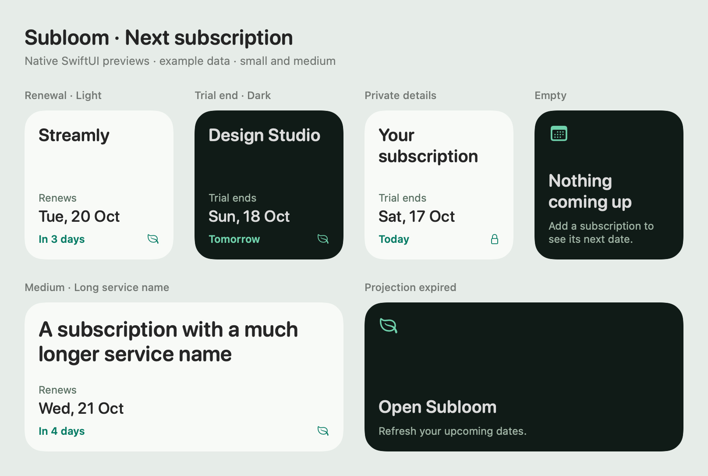

# Mac desktop widget

Subloom's **Next subscription** WidgetKit extension shows one nearest renewal or trial end. Small and medium widgets show the service name, event type, date and “Today”, “Tomorrow” or a day count. Clicking opens the corresponding subscription; private content opens the current workspace's calendar.

This is a native desktop/Notification Center widget, not a floating app window. **It is implemented and compiles, but gallery installation and real App Group sharing still require Apple Developer signing. This Mac currently has no valid code-signing identities.**

## Behavior and boundaries

- Dates come from the same `nextEvent` recurrence helper as the app. Paused, expired and canceled records are excluded. A trial end wins a tie with a renewal. Recurrence anchors, leap years and original account timezones are preserved. Renewals remain projections, not proof of payment.
- The Mac app writes only the nearest event for each of the next 35 days into its App Group. The extension has no network entitlement and receives no auth tokens, outbox, notes, receipt data, prices or complete subscription list.
- Widget timelines advance at account-local midnight, including daylight saving changes. At projection expiry the widget asks to open Subloom rather than continuing to show stale dates. macOS controls the actual refresh time; it may defer requested updates.
- The existing private-content preference hides merchant names and subscription IDs before writing shared data. Enabling privacy or changing workspace clears the old shared file. Session tokens reject delayed writes from older refreshes. WidgetKit can retain an already rendered snapshot until it processes the refresh request, so a shared-file clear is not a guarantee of immediate on-screen removal.
- Guest and account data remain separate. Sample and pre-onboarding workspaces publish an empty projection. Click handling checks the currently hydrated workspace and never switches accounts or opens an arbitrary URL.
- Preferences and subscriptions continue through the existing durable save/sync paths. No backend migration or new service credential is required.

## Build and install

For a separate **ad-hoc test build** that compiles and embeds the extension:

```sh
npm run build:macos -- --widget
```

Output: `build/Subloom-widget.app`. This verifies packaging and compilation but cannot enable shared widget data with an invented signing identity. The Mac app explains that limit under Settings → Reminders → Desktop widget.

For a signed local build, install your Apple Development or Developer ID Application identity in the Mac keychain, then supply:

| Build setting | Meaning |
| --- | --- |
| `MACOS_SIGN_IDENTITY` | Your installed signing certificate's name or fingerprint. |
| `MACOS_TEAM_ID` | Its matching ten-character Apple Developer Team ID. |
| `MACOS_WIDGET_APP_GROUP` | Optional macOS group override; defaults to `<TEAM_ID>.com.subloom.widgets`. It must have the same Team ID prefix. |

The builder puts the same group entitlement in the host and extension, embeds the group identifier in both Info plists, signs the extension before the host, and verifies signatures and the actual certificate Team ID. It rejects partial or mismatched configuration. It never installs certificates, creates keys or changes credentials. Standard unsigned CI builds omit the App Group entitlement rather than inventing one.

The macOS Team-ID-prefixed convention is documented by Apple and does not require a provisioning profile; it is Mac-only. See [Apple's App Group container guidance](https://developer.apple.com/documentation/xcode/accessing-app-group-containers). A `group.`-prefixed cross-platform group needs different provisioning and is deliberately not accepted by this build path. Notarization remains necessary before external Developer ID distribution.

After signing, install and launch that Mac app once, open your workspace, then control-click the desktop → **Edit Widgets** → **Subloom** → **Next subscription**. This gallery step must still be tested with your signing identity. Apple documents [widget extension setup and the initial app launch](https://developer.apple.com/documentation/widgetkit/creating-a-widget-extension).

Widget data belongs to the standalone Mac app's workspace. Website-only changes reach that workspace after account sync while the Mac app is open; browser guest data is separate.

## Validation

- TypeScript, lint and **310 tests across 53 files passed**, including nearest-event selection, tied trials, month ends/leap years, DST, privacy, sample isolation, explicit refresh and stale workspace responses.
- **26 native widget checks passed**, covering bounded payload validation, atomic file persistence, private permissions, owner/session isolation, privacy clearing, expired-state selection and safe widget links.
- **34 existing native storage/bridge checks passed**.
- The real Xcode extension target and full ad-hoc Mac host build passed; the embedded `com.apple.widgetkit-extension` bundle and deep signature verification passed. CI repeats both Intel and Apple Silicon Mac builds.
- Native SwiftUI small/medium previews cover light, dark, private, empty, long-name and expired states. The finishing review's contrast fix was scored resolved: 5.18:1 light and 8.10:1 dark supporting text. The reviewer returned **ship for that preview/source fix**, not for gallery installation.
- No installed-gallery, signed App Group, VoiceOver-runtime or multi-day system-scheduling claim is made. No runtime motion is authored. Existing DESIGN.md and its legacy metadata are preserved for this ordinary extension.

Reproduce previews with `npm run preview:macos:widget`, and native checks with `npm run test:macos:widget`. The image below uses explicitly synthetic data and renders the production SwiftUI content view.



Merge order: this feature PR targets `release-candidate`. Merge there first, then promote a reviewed release to `main` after signing and gallery acceptance. The preceding hosted tracker remains the current production release.
